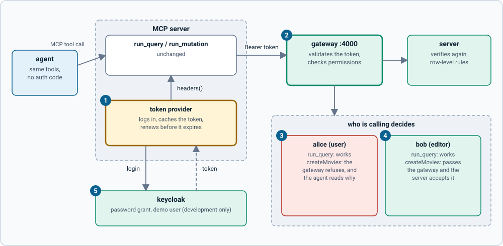

# Adding auth

This repo needs no login: it talks to the open `grandstack-server`. When you put `grandstack-auth` in front of the server, the same tools work with one change: they send a token.



1. **The token provider** logs in to Keycloak, keeps the token, and renews it shortly before it expires. It is passed to the tools as `headers`, a function called for every request.
2. **The gateway** (`:4000` in the auth setup) validates the token and checks what the user's role may do.
3. **alice (role `user`)** can read. A catalogue mutation is refused by the gateway, and the refusal text reaches the agent in the tool result, so it can tell the user why.
4. **bob (role `editor`)** passes the gateway and the server accepts it.
5. **Keycloak** here is the development realm from `grandstack-auth`.

Nothing in `grandstack-server`, `grandstack-web` or `grandstack-auth` changes, and the tools themselves are unchanged.

## The idea

- Point `GRAPHQL_URL` at the gateway (it is at `http://localhost:4000/graphql` in the auth setup, so the default URL already works).
- Give the executor a way to get a token. `headers` accepts a fixed object or a function that returns one (`createTools({ config, headers })`), so a function can fetch and refresh tokens.
- The agent then has exactly the permissions of that user's role.

## The example

`examples/with-auth/token-provider.ts` logs in with the password grant using the realm's `grandstack-smoke` client and caches the token until 30 seconds before it expires (concurrent calls share one login):

```ts
const tokenProvider = createTokenProvider({
  realmUrl: "http://localhost:8081/realms/grandstack",
  clientId: "grandstack-smoke",
  username: "alice", password: "alice-pass",
});
const server = createMcpServer(createTools({ config: loadConfig(), headers: tokenProvider }));
```

`examples/with-auth/server.ts` is that, wired to stdio. Register it with a client like the plain server:

```sh
AUTH_USER=alice npx tsx examples/with-auth/server.ts
```

Or in Claude Code: `claude mcp add grandstack-alice -e AUTH_USER=alice -e ALLOW_MUTATIONS=true -- npx --prefix /path/to/grandstack-agents tsx /path/to/grandstack-agents/examples/with-auth/server.ts`.

The same works for the direct approach: `graphqlTool(config, tokenProvider)`.

## Run the check

Start the auth stack (`docker compose -f compose.yaml -f compose.auth.yaml up --build` in `grandstack`), then:

```sh
npm run auth:check
```

It reports 9 passing checks: an anonymous agent can read but is refused writes ("Unauthenticated"); alice can read, is refused `createMovies` (`Forbidden: "createMovies" needs the "catalog:write" permission`), and can create a review as herself; bob can create a movie and delete it again; and the stdio example server, authenticated as alice, reads but cannot create movies.

## Practices

- **Least privilege.** Give an agent the weakest role that does the job. A `user` token cannot change the catalogue even if the agent tries.
- **Read-only is not a substitute.** `ALLOW_MUTATIONS=false` only affects this MCP server. A direct caller of the server gets nothing from it; the gateway's roles do the real work.
- **Token lifetime.** The development realm issues 5-minute tokens; the provider renews before expiry. A production client would also handle a revoked token.
- **Keep tokens out of prompts and logs.** The tools never put the token in a result, and errors name the user, not the token. Do not add it to system prompts.
- **Not for production.** The password grant and `grandstack-smoke` client are for the demo realm. Production agents should use a client-credentials grant (a service identity) or a user-delegated flow, with a client created for the agent. See [swapping providers](../../grandstack-auth/docs/swapping-providers.md) in `grandstack-auth`.
- **Memory later.** Agent memory, the next phase, is where auth becomes part of the design rather than an add-on.
