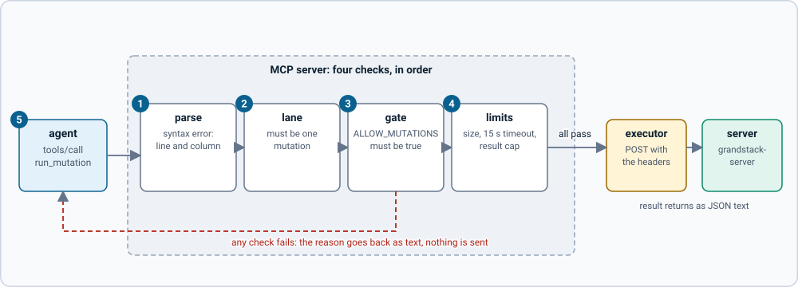

# How it works

## The pieces

| File | Role |
| --- | --- |
| `src/config.ts` | Reads the environment: `GRAPHQL_URL`, `ALLOW_MUTATIONS`, limits, port |
| `src/graphql.ts` | The **executor**: checks a document, POSTs it, enforces timeout and size cap. Both paths use it |
| `src/schema-tools.ts` | Reads the schema by introspection and renders a summary, one type, or everything |
| `src/tools.ts` | The four tools, shared by the MCP server and the agent example |
| `src/mcp.ts`, `src/stdio.ts`, `src/http.ts` | The MCP server and its two entry points |
| `src/agent.ts` | The agent loop and the single `graphql` tool for direct use |
| `examples/` | A Claude adapter and CLI (`direct/`), and the auth example (`with-auth/`) |

## Two paths, one executor

1. **An agent you write** holds the model, the loop and the tool call. It puts a schema summary in the system prompt.
2. **Any MCP client** needs no code from you: it lists the tools and calls them.
3. **The guarded executor** is where both paths meet. It parses the document, allows one operation, keeps queries and mutations apart, refuses mutations unless enabled, and applies a timeout and a size cap.
4. **`grandstack-server`** at `:4000` is open, with no auth.
5. **The MCP server** offers `get_schema`, `describe_type`, `run_query`, `run_mutation` over stdio or HTTP.

## One tool call, end to end

1. **parse**: a syntax error is returned with its line and column.
2. **lane**: `run_query` accepts only queries, `run_mutation` only mutations; subscriptions are not supported.
3. **gate**: `run_mutation` stops unless `ALLOW_MUTATIONS=true`.
4. **limits**: document size, a 15 s timeout, and results cut at 100 kB with a marker.
5. **A refusal comes back as text** with `isError: true`, so the agent can read it and change course. Nothing is sent to the server.

Errors from the GraphQL server are returned the same way, with any partial data, so an agent can fix its statement.

## Why the schema is read progressively

The generated GraphQL schema is about 34 KB. Putting it all in a prompt wastes context. `get_schema` returns about 4.6 KB: the root fields and the types the schema file defines, without the generated filter, sort and input types. `describe_type` fetches those one at a time when the agent needs them.

The schema an agent sees is only as helpful as its type definitions. See [designing the type definitions for agents](schema-design-for-agents.md).

## Stateless HTTP

The HTTP server creates a new MCP server per request and keeps no sessions. That makes it trivial to run in a container and to call with curl. The cost is that it cannot push notifications; these tools do not need to.
